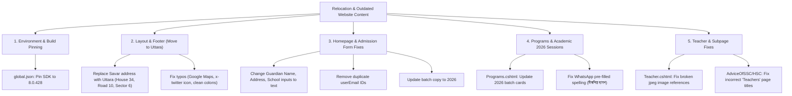

# Implementation Plan - Updating Spriha EduCare Website (Relocation to Uttara & 2026 Updates)

## Goal Description
Spriha EduCare has relocated its campus from Savar to **Uttara, Dhaka** (`House 34, Road 10, Sector 6, Uttara, Dhaka - 1230`), and the website needs to be refreshed from outdated 2024–2025 Savar-era content to current 2026/2027 academic operations.

In addition to replacing all Savar branch details with the new Uttara campus, the project requires fixing severe input validation bugs in the homepage admission form (where multiple text fields were incorrectly declared as `email`), correcting typographical errors, updating program batches to 2026/2027 sessions, fixing broken images in teacher views, and pinning the .NET 8 SDK to resolve MSBuild file access locks.

---

## User Review Required

> [!IMPORTANT]
> **Campus Relocation Confirmed**:
> All occurrences of "Savar Branch Location" and Savar addresses (`Mokhles Plaza, Savar City Center`) will be replaced with the active Uttara Campus:
> - **Address**: `House 34, Road 10, Sector 6, Uttara, Dhaka - 1230` (সেক্টর-০৬, রোড-১০, হাউজ-৩৪, উত্তরা, ঢাকা - ১২৩০)
> - **Google Maps Link**: Updated to route directly to Uttara Sector 6.
> 
> *Please confirm if you want Savar completely removed or if a mention of legacy Savar operations is needed anywhere.*

---

## Open Questions

1. **New Batch Details / Admissions**: Are there specific batch titles for 2026/2027 (e.g. "SSC 2026 Final Revision", "SSC 2027 Foundation Batch Alpha", "HSC 2026 Academic Batch") that you would like highlighted on the Programs page?
2. **Promotional Banners / Slides**: Should the current hero slides be kept as is, or do you have new banner graphics for the Uttara campus opening/classes?
3. **Featured Video**: Is the existing YouTube video on the landing page still valid, or do you have an updated video link for the Uttara campus?

---

## Proposed Changes



---

### 1. Environment & Build Configuration

#### [NEW] `global.json`
Create `global.json` in repository root to explicitly pin the build to the installed .NET 8 SDK (`8.0.428`), bypassing build locking issues from the .NET 11 preview SDK:
```json
{
  "sdk": {
    "version": "8.0.428",
    "rollForward": "latestFeature"
  }
}
```

---

### 2. Layout & Global Information

#### [MODIFY] [SprihaEduCare_Web/Views/Shared/_Layout.cshtml](file:///D:/GitHub/SprihaEduCare/SprihaEduCare_Web/Views/Shared/_Layout.cshtml)
- **Replace Savar Address with Uttara Campus**:
  - Replace:
    ```html
    <span style="color: #001844 ; font-weight: 600;">Savar Branch Location:</span>
    <span style="color: gray;">
        <a href="https://maps.app.goo.gl/RUZY7ZUSMmfmZoEt9/" target="_blank" style="color:dodgerblue">
            Mokhles Plaza (2nd Floor), Savar City Center, Savar, Dhaka - 1340
        </a>
    </span>
    ```
    With:
    ```html
    <span style="color: #001844 ; font-weight: 600;">Campus Location (উত্তরা ক্যাম্পাস):</span>
    <span style="color: gray;">
        <a href="https://maps.google.com/?q=House+34,+Road+10,+Sector+6,+Uttara,+Dhaka" target="_blank" style="color:dodgerblue">
            House 34, Road 10, Sector 6, Uttara, Dhaka - 1230
        </a>
    </span>
    ```
- **Fix Footer Typos & Icons**:
  - `Goggle Maps` -> `Google Maps`
  - `<i class="fa-brands fa-X"></i>` -> `<i class="fa-brands fa-x-twitter"></i>`
  - Fix double colons `Mobile 1::` -> `Mobile 1:`

---

### 3. Homepage & Admission Form

#### [MODIFY] [SprihaEduCare_Web/Views/Home/Index.cshtml](file:///D:/GitHub/SprihaEduCare/SprihaEduCare_Web/Views/Home/Index.cshtml)
- **Fix Admission Form Input Types & Attribute Clashes**:
  - Guardian Name: change `type="email"` to `type="text" id="guardianName" name="GuardianName" placeholder="Guardian Name"`.
  - Address: change `type="email"` to `type="text" id="userAddress" name="Address" placeholder="Address"`.
  - School/College: change `type="email"` to `type="text" id="institutionName" name="SchoolName" placeholder="School/College Name"`.
  - Ensure every input has unique IDs and valid name attributes for proper POST model binding.
- **Update Program / Batch Text**:
  - Update program references to 2026 academic sessions.
  - Fix spelling in WhatsApp query parameters: `বিকশিত দ্বাদশ` instead of `বিকশিত দাদশ`, `দীপ্ত নবম`, `স্ফুরিত দশম`.

---

### 4. Programs Page

#### [MODIFY] [SprihaEduCare_Web/Views/Home/Programs.cshtml](file:///D:/GitHub/SprihaEduCare/SprihaEduCare_Web/Views/Home/Programs.cshtml)
- Update academic session headers from `২০২৫` to `২০২৬` (e.g. `৯ম শ্রেণি একাডেমিক প্রোগ্রাম ২০২৬ (নতুন ব্যাচ)`, `১০ম শ্রেণি একাডেমিক প্রোগ্রাম ২০২৬`).
- Correct WhatsApp text parameters and card button anchors so students clicking "Details" or "Enroll Now" connect directly to WhatsApp with the selected course name.

---

### 5. Teacher Profile & Advice Pages

#### [MODIFY] [SprihaEduCare_Web/Views/Home/Teacher.cshtml](file:///D:/GitHub/SprihaEduCare/SprihaEduCare_Web/Views/Home/Teacher.cshtml)
- Update old image file paths pointing to deleted files (e.g., `2. Aribullah.jpeg`, `3. Win.jpeg`) to the current active `.webp` image assets in `teacher's img/`.

#### [MODIFY] [SprihaEduCare_Web/Views/Home/AdviceOfSSC.cshtml](file:///D:/GitHub/SprihaEduCare/SprihaEduCare_Web/Views/Home/AdviceOfSSC.cshtml) & [AdviceOfHSC.cshtml](file:///D:/GitHub/SprihaEduCare/SprihaEduCare_Web/Views/Home/AdviceOfHSC.cshtml)
- Update page title from `"Teachers"` to `"এস.এস.সি. পরীক্ষার পরামর্শ"` and `"এইচ.এস.সি. পরীক্ষার পরামর্শ"`.

---

## Verification Plan

### Automated Tests
1. **Compilation Check**:
   ```powershell
   dotnet build SprihaEduCare_Web.sln
   ```
   Verify 0 errors.

2. **Server Execution Check**:
   ```powershell
   dotnet run --project SprihaEduCare_Web --no-build
   ```
   Verify Kestrel launches without runtime startup exceptions.

### Manual Verification
1. **Footer & Location**:
   - Check footer displays Uttara campus address (`House 34, Road 10, Sector 6, Uttara, Dhaka - 1230`) and clicking the link opens Google Maps at Uttara.
2. **Admission Form**:
   - Fill out "ফ্রি ক্লাসের জন্য আবেদন" form with text in guardian name, address, and school fields to ensure no email validation error is triggered.
3. **Programs & WhatsApp Links**:
   - Click program cards to verify WhatsApp opens with the 2026 course and corrected spelling.
4. **Teacher Images**:
   - Inspect `/Home/Teacher` and `/Home/Teachers` to confirm teacher portraits load cleanly.
